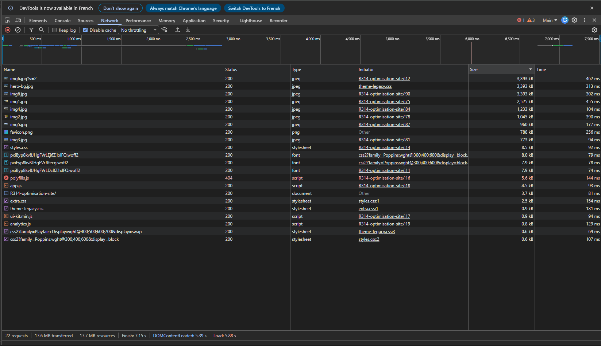
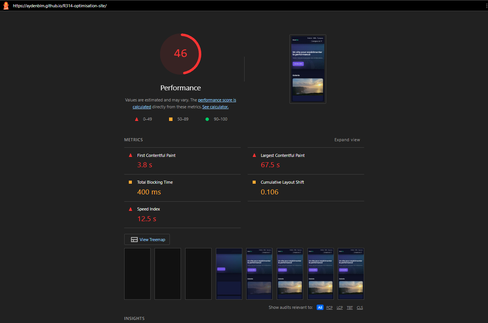
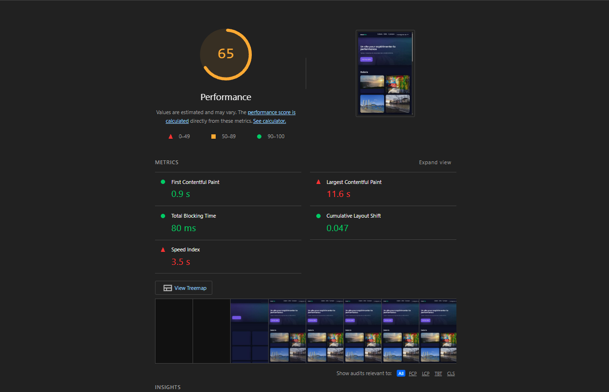
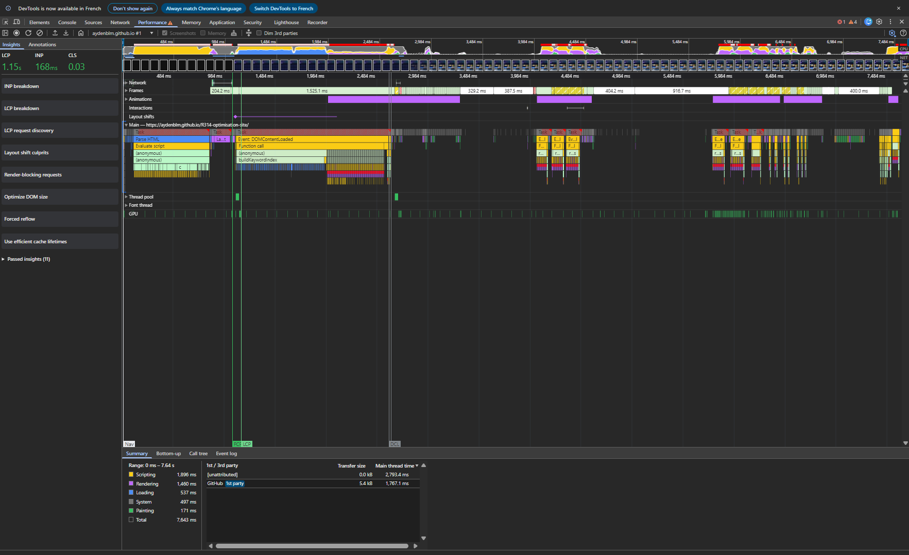
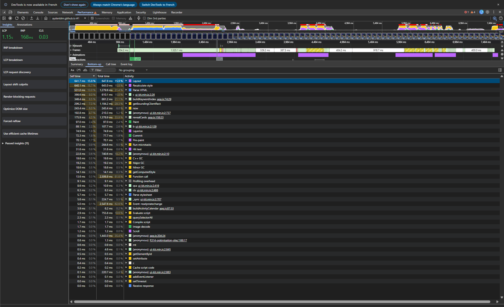
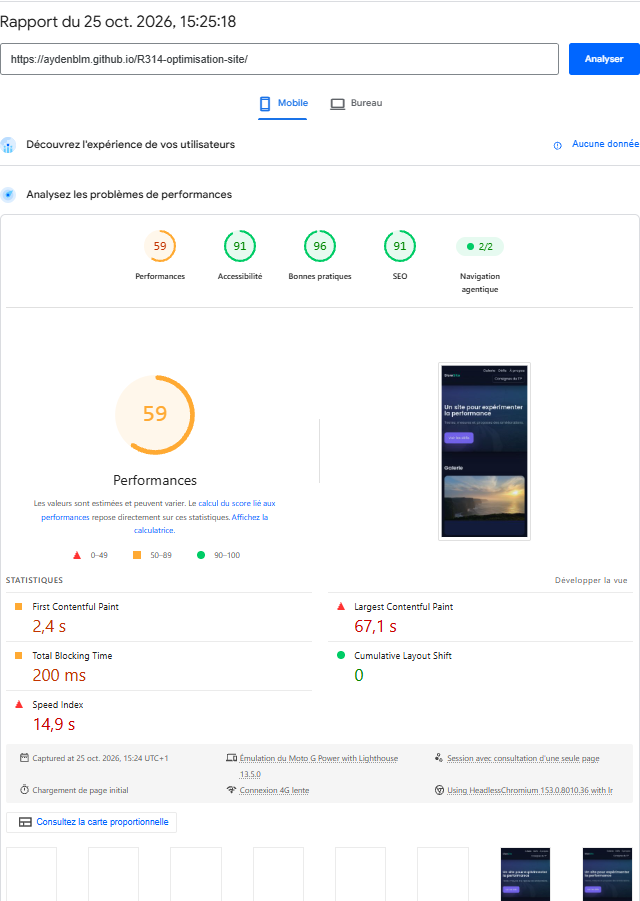
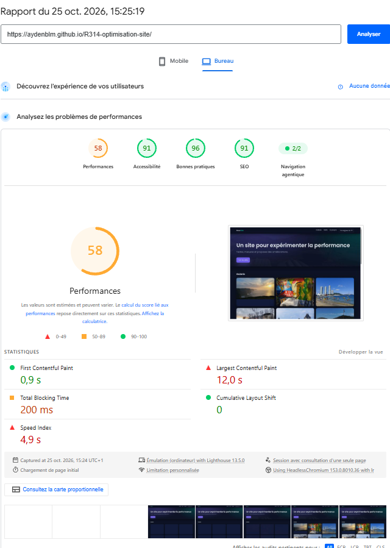

# Rapport d'optimisation : TP R3.14

- Site déployé : https://aydenblm.github.io/R314-optimisation-site/
- Fork : https://github.com/aydenblm/R314-optimisation-site

## 1. Conditions de mesure
- Navigateur : Chrome version 153.0.8010.53
- Fenêtre de navigation privée, extensions désactivées
- Cache désactivé
- Mesures sur le site déployé
- Date des mesures « avant » : 22/10/2026

## 2. Audit initial

### 2.1 Onglet Réseau

- Requêtes : 22
- Poids transféré : 17.6 MB

Les 5 ressources les plus lourdes :

| Fichier | Poids | Initiateur |
|---|---|---|
|`img6.jpg?v=2`|3,393 kB|`index.html` l.12|
|`hero-bg.jpg`|3,393 kB|theme-legacy.css|
|`img6.jpg`|3,393 kB|`index.html` l.90|
|`img1.jpg`|2,525 kB|`index.html` l.75|
|`img4.jpg`|1,233 kB|`index.html` l.84|

Anomalies repérées :
| Fichier | Status | Type | Initiateur | Constat |
|---|---|---|---|---|
|`polyfills.js`|404|script|`index.html` l.16|Le fichier n'existe pas sur le serveur : une requête pour rien (5,6 kB, 144 ms), dans le `<head>`|
|`img6.jpg` & `img6.jpg?v=2`|200|jpeg|`index.html` l.12 & `index.html` l.90|L'image est téléchargée deux fois car elle est initiée deux fois dans le code : un `<link rel="preload">` dans le `<head>` (avec `?v=2`) et une `` dans le `<body>`. Les deux URL sont différentes, donc le navigateur ne réutilise pas la première. Le preload n'est jamais utilisé (avertissement console) : 3 393 kB gaspillés|
|`img1.jpg` à `img6.jpg`|200|jpeg|`index.html` l.75 à l.90|Photos en taille d'origine (3968x2240 pour `img1.jpg`, 3968x2976 pour `img6.jpg`, 2040x1530 pour les autres), de 773 kB à 3 393 kB chacune, pour de simples vignettes de galerie. Problème de taille distinct du doublon d'`img6.jpg`|
|`hero-bg.jpg`|200|jpeg|`theme-legacy.css`|Image de 3 393 kB demandée par un CSS (`.hero::before`), alors qu'elle n'est pas visible sur la page (`opacity:.04`). C'est aussi exactement le même fichier que `img6.jpg` (même md5) : la même photo est téléchargée 3 fois|
|`favicon.png`|200|png|Other|788 kB pour une icône affichée en 16x16 : le fichier fait 512x512 px|
|`extra.css`|200|stylesheet|`styles.css` l.1|Appelé par un `@import` : il n'est découvert qu'après le téléchargement de `styles.css`|
|`theme-legacy.css`|200|stylesheet|`extra.css` l.1|Deuxième `@import` imbriqué : chaîne `index.html → styles.css → extra.css → theme-legacy.css`. Chaque fichier attend le précédent, ce qui retarde l'affichage|
|`css2?family=Playfair+Display...`|200|stylesheet|`theme-legacy.css` l.3|Feuille de police demandée en bout de chaîne `@import`, alors qu'aucune page n'utilise `.legacy-title` ni `.legacy-quote`. Aucun fichier `.woff2` n'est téléchargé : la requête ne sert à rien|
|`css2?family=Poppins...`|200|stylesheet|`styles.css` l.2|Chargée par `@import` avec `display=block` : le texte reste invisible (jusqu'à environ 3 s) tant que la police n'est pas arrivée. Les graisses 300, 400 et 600 sont demandées|
|`pxiByp8kv8JHgFVrLDz8Z1xlFQ.woff2`|200|font|`index.html` l.11|Police préchargée sans attribut `crossorigin` : le navigateur ne la réutilise pas (avertissements console « credentials mode does not match » et « preloaded but not used »)|
|`ui-kit.min.js`|200|script|`index.html` l.17|Script sans `defer` dans le `<head>` : bloque l'analyse du HTML|
|`app.js`|200|script|`index.html` l.18|Script sans `defer` dans le `<head>` : bloque l'analyse du HTML|
|*(aucune requête)*|-|-|`index.html` l.9|`<link rel="dns-prefetch" href="https://cdn.jsdelivr.net">` : aucune des 22 requêtes ne va vers `cdn.jsdelivr.net`, et rien dans le site n'utilise ce domaine. Le préchargement DNS ne sert à rien|

Pistes repérées à la lecture du code, à confirmer par la mesure :
- `ui-kit.min.js` : boucle de ~620 ms et 240 000 objets au chargement ; `MutationObserver` qui relit les styles de tous les éléments à chaque mutation → à vérifier au panneau Performance (2.3)
- `analytics.js` : `setInterval` de 2,6 s démarré 6,5 s après `load`, uniquement si la largeur dépasse 1024 px, avec une durée croissante jusqu'à 430 ms → à vérifier par un enregistrement long en desktop puis en mobile (2.3)
- `extra.css` : classes `.extra-N` a priori inutilisées → à vérifier avec l'onglet Coverage
- Poppins : graisses 300, 400 et 600 demandées → à comparer à celles réellement utilisées par le CSS

### 2.2 Lighthouse (DevTools)

| Profil | Score | FCP | LCP | TBT | CLS | Speed Index |
|---|---|---|---|---|---|---|
| Mobile | 46 | 3,8 s | 67,5 s | 400 ms | 0,106 | 12,5 s |
| Desktop | 65 | 0,9 s | 11,6 s | 80 ms | 0,047 | 3,5 s |

- Élément LCP : `
` (le bandeau principal), dans les deux profils. Il s'agit en fait de l'image d'arrière-plan `hero-bg.jpg` (3 393 kB, `.hero::before` dans `theme-legacy.css`) : l'audit « prioritize-lcp-image » cite `hero-bg.jpg`. Lighthouse note que la requête n'est pas découvrable dans le document initial (elle n'apparaît qu'au bout de la chaîne `@import`) et qu'elle n'a pas `fetchpriority=high`
- Responsables du CLS : mobile 0,106 et desktop 0,047. Dans le rapport Lighthouse en ligne de commande que j'ai lu en détail, le décalage venait de `div#galerie`, causé par le chargement des polices web Poppins (2 fichiers `.woff2`). À confirmer dans le détail « Layout shift culprits » de mon propre rapport DevTools. Lighthouse signale aussi les 6 images de la galerie sans `width`/`height` (`unsized-images`)
- Ressources bloquant le rendu : `app.js`, `ui-kit.min.js`, `styles.css`, `extra.css`, `theme-legacy.css`, `polyfills.js`, et les feuilles Google Fonts Poppins (807 ms perdues sur mobile) et Playfair Display (162 ms). Économie estimée : 2 580 ms sur mobile, 680 ms sur desktop
- Chaîne critique : `index.html → styles.css → (css2 Poppins → 2 × .woff2) et (extra.css → theme-legacy.css → css2 Playfair)`, plus `app.js`, `ui-kit.min.js` et `polyfills.js` demandés directement par `index.html`. On retrouve la chaîne `@import`. Chaîne la plus longue : 1 617 ms sur mobile (jusqu'aux polices), 1 073 ms sur desktop
- Ce que Lighthouse a détecté et que j'avais déjà repéré :
  - le poids total de 17 143 KiB ;
  - les images démesurées : économie estimée de 10 977 KiB (`image-delivery-insight`), dont 9 115 KiB d'images trop grandes pour leur affichage de 379×284 px ;
  - `hero-bg.jpg` parmi les plus lourdes ;
  - la chaîne `@import` `styles.css → extra.css → theme-legacy.css` ;
  - la feuille Playfair Display inutile ;
  - `app.js`, `ui-kit.min.js` et `polyfills.js` bloquant le rendu ;
  - `ui-kit.min.js` comme principale tâche longue (2 543 ms sur mobile, 640 ms sur desktop) ;
  - `analytics.js` comme tâche longue (540 ms sur mobile, 127 ms sur desktop)
- Ce que Lighthouse a détecté de nouveau :
  - l'élément LCP est l'image de fond du bandeau, avec requête non découvrable et sans `fetchpriority` ;
  - les images en JPEG qu'on pourrait servir en WebP/AVIF : 4 269 KiB d'économie estimée ;
  - 744 KiB d'économie estimée par une meilleure compression ;
  - aucun cache longue durée sur 14 ressources (14 978 KiB) ;
  - pas de `preconnect` vers `fonts.googleapis.com` : 150 ms d'économie estimée ;
  - des reflows forcés, dont un dans `app.js` (86 ms) ;
  - un `font-display` à corriger sur les polices Poppins ;
  - des images sans `width`/`height`
- Ce que j'ai repéré mais que Lighthouse n'a PAS vu :
  - le 404 de `polyfills.js` : il apparaît seulement comme ressource bloquante de 0 octet, sans mention de l'erreur ;
  - le doublon `img6.jpg` / `img6.jpg?v=2` : les deux fichiers sont comptés séparément dans le poids, sans lien entre eux ;
  - le `<link rel="preload">` de `img6.jpg?v=2` jamais utilisé, et le preload de police sans `crossorigin` (ce sont des avertissements de la console, hors catégorie Performance) ;
  - le `dns-prefetch` vers `cdn.jsdelivr.net`, inutile ;
  - le fait que `hero-bg.jpg` soit identique à `img6.jpg` (même md5) et affiché à `opacity:.04` ;
  - le `display=block` sur Poppins (texte invisible) ;
  - `favicon.png` de 788 kB en 512×512 px pour une icône de 16×16 : il n'apparaît que dans la liste du poids total

*Tableau et captures : Lighthouse du panneau DevTools de Chrome. Les puces ci-dessus (éléments, économies estimées, tâches longues) viennent d'un rapport Lighthouse 12.8.2 lancé en ligne de commande, pas du rapport DevTools.*

### 2.3 Panneau Performance (CPU ×4)

Enregistrement A : 7,64 s seulement (rechargement avec ⟳, arrêt avant les 40 s du scénario).

Top 3 du Bottom-Up (Self Time) :
| Fonction | Fichier | Temps |
|---|---|---|
|`Layout`|(natif)|641,7 ms (15,8 %)|
|`Recalculate style`|(natif)|640,1 ms (15,7 %)|
|`Parse HTML`|(natif)|531,0 ms (13,0 %)|

Fonctions JavaScript les plus coûteuses (Self Time) : `c` (`ui-kit.min.js`) 366,6 ms, `buildKeywordIndex` (`app.js` l.74) 346,4 ms, `getBoundingClientRect` 296,2 ms, `now` 243,4 ms, `revealCards` (`app.js` l.158) 175,9 ms.

- Au chargement : la frise montre un premier bloc dominé par `Evaluate script` puis `c` : c'est la calibration de `ui-kit.min.js`. Sa boucle appelle `performance.now()` : `c` (366,6 ms) + `now` (243,4 ms) font environ 610 ms, ce qui est cohérent avec la boucle de 620 ms lue dans le code. Vient ensuite le gestionnaire `DOMContentLoaded` avec `buildKeywordIndex` (346,4 ms de temps propre, 861,2 ms au total)
- Pendant le scroll : des blocs apparaissent à chaque défilement (images 329, 387, 404 et 916 ms sur la frise). Le Bottom-Up montre `revealCards` (`app.js` l.158) avec 1 378,9 ms au total (33,9 %), `getBoundingClientRect` 296,2 ms de temps propre, et surtout `Layout` et `Recalculate style` autour de 640 ms chacun : `revealCards` relit des mesures de mise en page après avoir écrit des styles, ce qui force le navigateur à recalculer à chaque évènement. Le panneau Insights signale d'ailleurs « Forced reflow ». `getComputedStyle` ne pèse que 14,1 ms et `_sync` (le `MutationObserver` de `ui-kit.min.js`) 224,7 ms au total
- Pendant l'inactivité : non mesuré. L'enregistrement A s'arrête à 7,64 s, sans phase de pause

Test de la condition de largeur (`analytics.js`) : non réalisé. Les deux enregistrements faits après rechargement durent environ 4 s et 3,5 s, or le minuteur d'`analytics.js` ne démarre que 6,5 s après `load` : le script n'y apparaît pas. La piste « boucle croissante, uniquement au-dessus de 1024 px » reste donc une lecture du code, non confirmée par une mesure.

### 2.4 PageSpeed Insights

| Profil | Score | FCP | LCP | TBT | CLS | Speed Index |
|---|---|---|---|---|---|---|
| Mobile | 59 | 2,4 s | 67,1 s | 200 ms | 0 | 14,9 s |
| Bureau | 58 | 0,9 s | 12,0 s | 200 ms | 0 | 4,9 s |

PageSpeed Insights n'affiche aucune donnée de terrain (CrUX) pour ce site : il n'a pas assez de trafic réel, seules les mesures de laboratoire (Lighthouse) sont disponibles.

Valeurs d'un seul lancement par profil, le 25/10/2026 à 15:25.